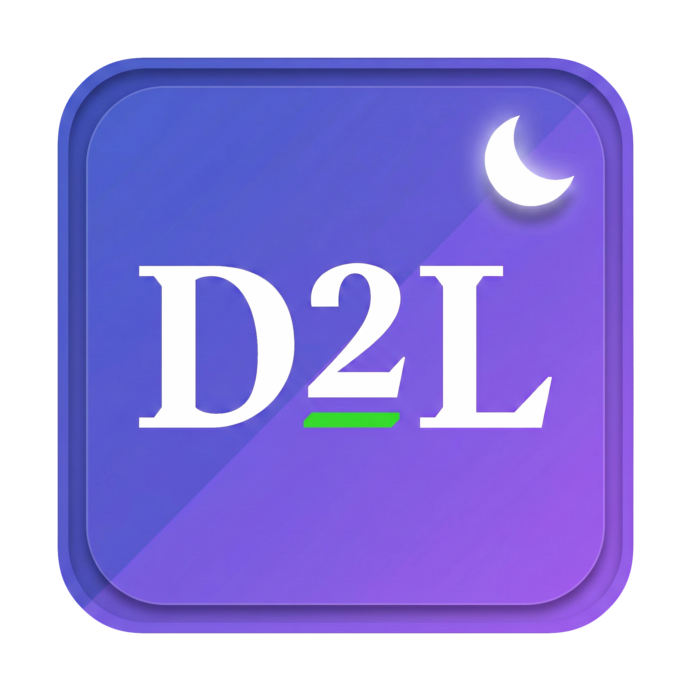

  

# DarkSpace: D2L Brightspace Dark Mode

A browser extension that brings dark mode to D2L Brightspace LMS. Automatically detects Brightspace pages, no setup needed.

## Features

- **Automatic detection**: DOM fingerprinting works on any Brightspace instance with no hard-coded domains
- **Shadow DOM support**: styles injected into D2L's Lit-based web components
- **Media handling**: images, videos, and canvas elements are counter-inverted to display in their original colors
- **Document dark mode**: optional toggle to darken embedded PDFs, slides, and document viewers
- **Video dark mode**: optional toggle to keep video players inverted
- **Custom domains**: add or exclude specific domains
- **Privacy-first**: zero data collection, all settings stored locally

## Installation

### Install From Stores

Works in Chrome, Edge, and other Chromium browsers, and in Firefox 153 or newer.

### Install Manually

**Chrome / Edge**

1. Clone, download this repository, or download the [release](https://github.com/abujalao/d2l-dark-mode/releases) and unzip.
2. Open the extensions page: `chrome://extensions` in Chrome, `edge://extensions` in Edge
3. Enable **Developer mode**
4. Click **Load unpacked** and select the repository folder

**Firefox**

1. Download Firefox [release](https://github.com/abujalao/d2l-dark-mode/releases) zip file
2. Open `about:debugging#/runtime/this-firefox`
3. Click **Load Temporary Add-on** and select the zip file

Temporary add-ons are removed when Firefox closes; install from Firefox Add-ons to keep it.

## Usage

Click the extension icon to open the popup. Controls include a power toggle, document/video dark mode switches, custom domain management, and reset to defaults.

If your institution's Brightspace isn't detected, add it via **Custom Domains** in the popup.

## How It Works

Applies `filter: invert(1) hue-rotate(180deg)` on the top-frame `<html>`, then counter-inverts media (images, video, canvas) so they display in original colors. Child frames inherit the dark appearance via parent compositing. Shadow roots receive counter-inversion rules via `adoptedStyleSheets`.

## Privacy

Zero user data collected. All preferences stored locally via `chrome.storage.sync`. See [PRIVACY.md](PRIVACY.md) for the full policy.
